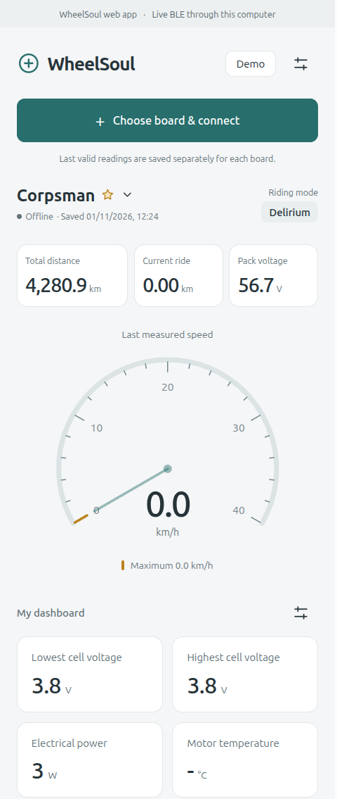

# WheelSoul

An independent local telemetry dashboard for older Onewheel XR boards. WheelSoul
started as a replacement for an obsolete OneWave Android app and is being developed
by PascalCorpsman with an AI assistant using Copilot SDK in VS Code.

**This repository currently contains a browser dashboard and a local Python BLE
server, not an Android APK.** The browser interface is the design prototype for a
future Android app.



*Example dashboard with custom fields. Unavailable readings are shown as `-`.*

## What it does

- Scan for nearby Onewheel boards and select one to connect. No hard-coded BLE address.
- Give each board a local name and choose a favorite.
- Authenticate supported legacy Gemini boards without the official app, an account,
  pairing PIN, or an Internet connection.
- Display all 15 battery cell-group voltages, minimum, maximum, average, and imbalance.
- Display pack voltage, battery percentage, signed current, estimated electrical
  power, current speed, current ride distance, lifetime distance, and riding mode.
- Display controller, motor, and battery temperatures when available.
- Show an analog speed gauge with a held, board-specific maximum pointer.
- Configure the three main fields; add, remove, reorder, and customize extra fields,
  including individual cell groups and decimal precision.
- Keep board names, layout, last valid readings, and observed maxima in browser-local
  storage. Offline readings are explicitly marked as saved, not live.
- Provide two fictional demo boards, isolated from real board history.
- Auto-connect a visible favorite while the real dashboard is in the foreground and
  no connection is active. A manual disconnect suppresses auto-connect until an
  explicit connection or reload.

The connection button is directly below the header: selecting a board comes first.

## Tested hardware and compatibility

| Component | Verified environment |
|---|---|
| Board | Onewheel XR |
| Hardware revision | 4206 |
| Firmware | Gemini 4134 |
| Riding mode | Delirium |
| Computer | Linux with BlueZ and a BLE-capable adapter |
| Python | 3.12 |
| Node.js | 22.23.4 |

The original standalone prototype was tested with local authentication and a
75-second telemetry session without opening the official app. It reported all
15 cell groups at 3.80 V, 0 mV measured imbalance, about 56.7 V pack voltage, and
about 4,280.9 lifetime km. Locked zero readings were rejected.

The repository's Python server and browser bridge were also verified on this board:
local Gemini authentication succeeded, followed by 75.13 seconds of observation
with 99 telemetry frames. All 15 groups stayed fresh throughout the final 30 seconds,
each at 3.80 V, with 0 mV measured imbalance. The mode remained Delirium; live values
reached the browser and its board-specific cache. Local naming and favorite selection
were exercised in the browser as well.

Only this XR hardware/firmware combination has been hardware-tested. The local
handshake implementation accepts legacy XR hardware 4000-4209 with firmware
4001-4140; this is a protocol gate, **not a guarantee that every combination works**.
Newer firmware and newer models are not supported by this handshake. XR firmware
4155 and later removes cell-voltage access according to the community protocol
reference. WheelSoul will not downgrade or modify a board to regain access.

The Pixel 7 Pro is the intended future Android target, not a tested native platform.

## Run the dashboard on your computer

### Requirements

- Linux with BlueZ, a working BLE adapter, and permission to use Bluetooth.
- Python 3.11 or newer.
- Node.js 22.18 or newer in the Node 22 line, or a recent supported Node release.
- npm.

The following commands are for Linux. Bleak also has macOS and Windows backends,
but this project has not yet been tested on those systems.

```sh
git clone https://github.com/PascalCorpsman/WheelSoul.git
cd WheelSoul

python3 -m venv .venv
.venv/bin/python -m pip install -r requirements.txt
npm ci
npm run build
npm start
```

Open **http://127.0.0.1:8080/** on the same computer. Keep the server terminal open.
The dashboard starts in demo mode:

1. Switch **Demo** off.
2. Switch on your board and keep it nearby.
3. Close the official app and other BLE clients.
4. Select **Choose board & connect**, scan, and connect to the desired board.
5. Use the settings button to add **All 15 cell groups**, **Cell imbalance**, or
   other fields. The initial screen deliberately has no extra tiles.

Do not pair the board with a PIN such as `0000`: this is a BLE GATT connection, not
classic Bluetooth pairing. Leave the board stationary while testing.

An equivalent server command, with an optional port, is:

```sh
PYTHONPATH=src .venv/bin/python -m wheelsoul --port 8080
```

Stop the server with Ctrl+C. Disconnecting stops the BLE session and keepalive.
Closing the last dashboard event connection also disconnects the board. If several
tabs are open, they share the server's one active board connection.

A local `./run.sh` shortcut, if present, rebuilds the dashboard, starts the server,
and opens the default browser when it is ready. Run it after installing the
dependencies above; Linux needs `curl` and `xdg-open` (usually provided by
`xdg-utils`). Keep its terminal open and use Ctrl+C to stop the server it started.
If WheelSoul is already running, the shortcut opens that instance instead; restart
the existing server separately to load Python changes. This local helper is
intentionally Git-ignored and is **not included when cloning the repository**.

### Demo without Bluetooth

After the installation and build above:

```sh
PYTHONPATH=src .venv/bin/python -m wheelsoul --demo-only
```

The dashboard still works, but the server explicitly disables real BLE commands.
For front-end development alone:

```sh
npm run dev
```

Open the Vite URL printed in the terminal. Vite serves the GUI/demo only; real BLE
requires the built dashboard served by the Python server.

### Can the browser actually connect?

**Yes, through the local server.** The browser sends local HTTP commands and receives
WebSocket telemetry; Python/Bleak connects to the computer's Bluetooth adapter.
This does not require browser Web Bluetooth support.

The server listens only on `127.0.0.1`. Opening its URL on a phone does not turn the
phone into a BLE client. A publicly hosted static page cannot use this local
same-origin BLE API. The future Android app will need its own native BLE transport.

## Safety and measurement limitations

- No firmware flashing, riding-mode changes, lights, or configuration writes.
- The only board writes are the existing firmware value used as a session command,
  the legacy challenge response, and authentication notification subscription
  changes. These are needed to authenticate and maintain telemetry.
- The server accepts only loopback, same-origin requests and checks an ephemeral
  session token for commands and events. Do not expose it through a public proxy.
- Authentication/protocol failures are shown explicitly. The last valid sample is
  retained; locked values are never treated as real measurements.
- On Gemini 4134, cell voltage resolution is **20 mV**. A displayed 0 mV imbalance
  means no difference was resolved; it does not establish laboratory-level balance.
- A complete cell summary requires all 15 groups sampled within 30 seconds.
  Initial collection takes time; unavailable/stale groups are not shown as zero.
- Positive current means discharge; negative current means charge/regeneration.
- Temperature bytes are decoded using the community protocol. Sensor availability
  and calibration have not been independently verified. A zero motor-temperature
  byte on supported legacy XR boards is conservatively treated as unavailable,
  not as a measured 0 degrees Celsius. This also applies to older cached motor
  readings. Unknown readings display `-`; valid zeros such as speed, current, or
  cell imbalance remain zero. No temperature is estimated from room temperature.
- Speed and ride distance use a nominal 0.91766 m tire circumference. Tire size and
  pressure affect accuracy. Reverse-motion conversion is implemented but untested
  on hardware.
- The board's 16-bit ride-rotation counter wraps at roughly 60.14 km and can reset
  when the board restarts. Lifetime distance originates from whole miles.
- **Recorded maximum** means the highest speed observed by WheelSoul for that board,
  not a historical maximum retrieved from the board or a guarantee that brief
  peaks between samples were captured.
- Browser data is specific to the browser profile and URL origin. Changing ports,
  switching between `localhost` and `127.0.0.1`, or clearing storage creates a separate
  cache. Demo data never updates real board maxima.
- This is a diagnostic prototype, not a safety instrument or a riding aid.

See [README-BLE.md](./README-BLE.md) for the discovered services, permissions, and
protocol notes.

## Source layout and tests

All application and test source lives under `src`:

```text
src/
  wheelsoul/        Python BLE protocol, local HTTP/WebSocket server, CLI entry point
  web/             English React/TypeScript GUI, model, bridge, CSS and Vite config
    tests/         Front-end model and event-validation tests
  tests/           Python protocol and HTTP/WebSocket integration tests
```

Dependency manifests and documentation are in the repository root. `dist`, virtual
environments, dependencies, APKs, local state, and diagnostic logs are ignored.

```sh
npm test
npm run build
npm run lint
PYTHONPATH=src .venv/bin/python -m unittest discover -s src/tests -v
```

Tests use synthetic board identifiers and mocked BLE clients. They do not connect
to hardware or require a Bluetooth adapter.

## References and publication

Protocol facts were researched from the obsolete OneWave APK and
[Onewheel Community Edition](https://github.com/OnewheelCommunityEdition/OWCE_App).
The upstream OWCE application uses GPL-3.0; WheelSoul's implementation was written
separately rather than copying its application source.

WheelSoul is unofficial and is not affiliated with Future Motion. Product names
belong to their respective owners. The original APK and private board addresses are
not included. A project license has not yet been selected; do not assume a reuse
license from this README. Licensing and native Android packaging remain publication
tasks.
